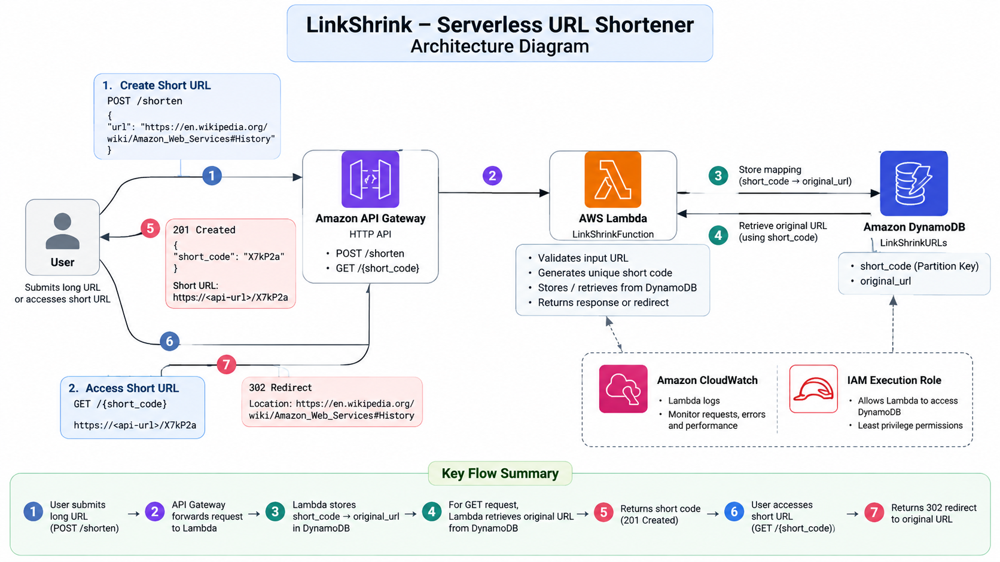
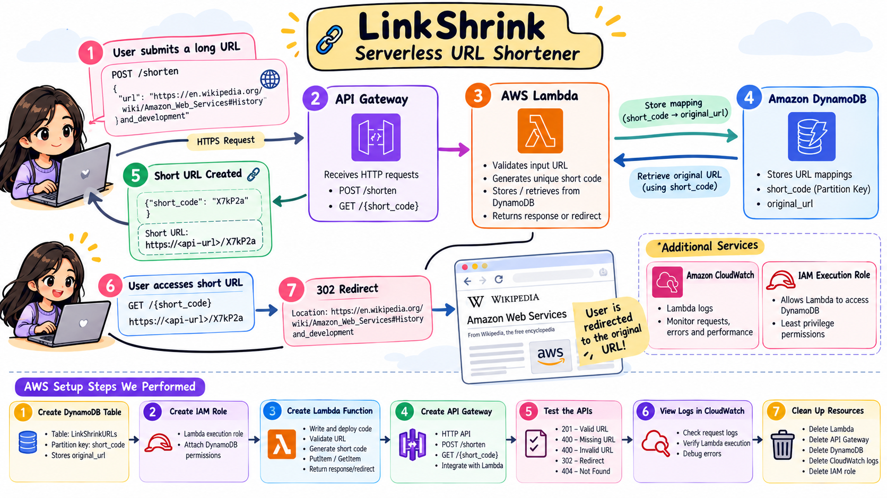

# 🔗 LinkShrink — Serverless URL Shortener

<p align="center">
  <strong>A lightweight, serverless URL shortening service built with AWS.</strong>
  <br />
  Transform long URLs into short, shareable links with automatic redirection.
</p>

<p align="center">
  
  
  
  
</p>

<p align="center">
  <a href="https://github.com/swanandihelambe/LinkShrink">GitHub Repository</a>
</p>

---

## 📌 Table of Contents

- Overview
- Problem Statement
- Key Features
- System Architecture
- How It Works
- AWS Services Used
- API Documentation
- Error Handling
- Project Structure
- Testing and Validation
- Technologies Used
- Screenshots
- Future Enhancements
- Learning Outcomes

---

## 🚀 Overview

**LinkShrink** is a serverless URL shortener developed using Amazon Web Services (AWS).

It converts lengthy URLs into compact, six-character alphanumeric short codes. When someone accesses a generated short link, the application retrieves the corresponding original URL from Amazon DynamoDB and redirects the user automatically.

The project demonstrates the implementation of a lightweight, event-driven backend using managed AWS services without maintaining dedicated servers.

## 🎯 Problem Statement

Long URLs can be difficult to share, remember, and manage, especially across messaging platforms and digital communication channels.

LinkShrink addresses this problem by providing:

- Short and convenient URL references.
- Reliable mapping between short codes and original URLs.
- Automatic redirection to the original destination.
- A scalable serverless backend.

## ✨ Key Features

| Feature | Description |
|---|---|
| URL Shortening | Generates six-character alphanumeric short codes. |
| URL Validation | Accepts valid HTTP and HTTPS URLs. |
| Unique Code Generation | Checks DynamoDB before storing a generated code. |
| Persistent Storage | Stores URL mappings in Amazon DynamoDB. |
| Automatic Redirection | Redirects users using HTTP 302 responses. |
| Error Handling | Handles missing inputs, invalid URLs, and unknown codes. |
| Serverless Execution | Uses AWS Lambda without managing servers. |
| Monitoring | Uses Amazon CloudWatch for execution logs. |

## 🏗️ System Architecture

LinkShrink follows a serverless architecture in which API Gateway receives client requests, Lambda processes the application logic, and DynamoDB stores URL mappings.

<p align="center">
  
</p>

### Architecture Components

- **Client:** Sends URL shortening and redirection requests.
- **Amazon API Gateway:** Exposes HTTP endpoints and forwards requests to Lambda.
- **AWS Lambda:** Executes URL validation, short-code generation, database operations, and redirection logic.
- **Amazon DynamoDB:** Stores short codes and their corresponding original URLs.
- **AWS IAM:** Provides permissions for Lambda to access DynamoDB.
- **Amazon CloudWatch:** Collects Lambda execution logs for monitoring and debugging.

## ⚙️ How It Works

### 1. URL Shortening Workflow

1. The client sends a POST request containing the original URL.
2. API Gateway forwards the request to AWS Lambda.
3. Lambda validates the URL and checks its format.
4. A unique six-character alphanumeric short code is generated.
5. Lambda checks DynamoDB to avoid an existing short code.
6. The short code and original URL are stored in DynamoDB.
7. A successful response containing the short code is returned.

### 2. URL Redirection Workflow

1. The client accesses the short URL using its short code.
2. API Gateway forwards the GET request to Lambda.
3. Lambda retrieves the corresponding record from DynamoDB.
4. If the short code exists, Lambda returns an HTTP 302 response with the original URL in the `Location` header.
5. If the short code does not exist, a 404 response is returned.

<p align="center">
  
</p>

## ☁️ AWS Services Used

| AWS Service | Purpose |
|---|---|
| Amazon API Gateway | HTTP API and request routing |
| AWS Lambda | Serverless application logic |
| Amazon DynamoDB | NoSQL database for URL mappings |
| AWS IAM | Access management and permissions |
| Amazon CloudWatch | Logging and monitoring |

## 🔌 API Documentation

LinkShrink exposes two primary HTTP endpoints.

### 1. Create a Short URL

**Endpoint:** `POST /shorten`

**Request Body:**

```json
{
  "url": "https://example.com"
}
```

**Successful Response — 201 Created**

```json
{
  "short_code": "aB12xY"
}
```

The short code above is illustrative; actual codes are generated dynamically.

### 2. Redirect to Original URL

**Endpoint:** `GET /{short_code}`

Example:

```http
GET /aB12xY
```

**Successful Response — 302 Found**

```http
Location: https://example.com
```

The browser follows the redirect and opens the original destination.

## ⚠️ Error Handling

| HTTP Status | Description |
|---|---|
| `201 Created` | Short URL generated successfully |
| `302 Found` | Redirect to the original URL |
| `400 Bad Request` | Missing or invalid request data |
| `404 Not Found` | Short code does not exist |
| `405 Method Not Allowed` | Unsupported HTTP method |

## 📁 Project Structure

```text
LinkShrink/
│
├── lambda_function.py
├── README.md
├── architecture.png
├── working.png
│
└── screenshots/
    ├── API-Gateway/
    ├── CloudWatch/
    ├── DynamoDB/
    ├── IAM/
    └── Lambda/
```

## 🧪 Testing and Validation

The application was tested using AWS Lambda test events and API Gateway.

| Test Scenario | Expected Result |
|---|---|
| Valid URL submission | 201 Created |
| Missing URL | 400 Bad Request |
| Invalid URL | 400 Bad Request |
| Existing short code | 302 Redirect |
| Nonexistent short code | 404 Not Found |
| Unsupported HTTP method | 405 Method Not Allowed |

CloudWatch execution logs were also reviewed to verify Lambda execution and assist with troubleshooting.

## 🛠️ Technologies Used

| Category | Technology |
|---|---|
| Programming Language | Python |
| Cloud Platform | Amazon Web Services |
| API Management | Amazon API Gateway |
| Compute | AWS Lambda |
| Database | Amazon DynamoDB |
| SDK | Boto3 |
| Security | AWS IAM |
| Monitoring | Amazon CloudWatch |

## 📸 Screenshots

Explore the implementation and configuration of each AWS service:

| AWS Component | Screenshots |
|---|---|
| API Gateway | [View Screenshots](screenshots/API-Gateway/) |
| AWS Lambda | [View Screenshots](screenshots/Lambda/) |
| DynamoDB | [View Screenshots](screenshots/DynamoDB/) |
| IAM | [View Screenshots](screenshots/IAM/) |
| CloudWatch | [View Screenshots](screenshots/CloudWatch/) |

## 🔮 Future Enhancements

Potential improvements for future versions include:

- Custom short URLs.
- QR code generation.
- URL expiration and automatic cleanup.
- Click analytics and usage statistics.
- User authentication and personalized dashboards.
- Rate limiting and abuse prevention.
- Infrastructure as Code using AWS SAM or AWS CloudFormation.

## 🎓 Learning Outcomes

Through this project, I gained practical experience in:

- Designing and implementing serverless architectures on AWS.
- Building HTTP APIs using Amazon API Gateway.
- Developing Python-based AWS Lambda functions.
- Integrating Lambda with DynamoDB using Boto3.
- Implementing URL validation and HTTP redirection.
- Configuring IAM permissions for AWS service access.
- Monitoring application execution through CloudWatch.
- Testing API workflows and handling application errors.

## 📌 Project Status

**Implementation and functional testing: Completed.**

The application was deployed and tested using AWS services. The AWS resources have since been deleted to avoid ongoing charges.

This repository preserves the project source code, architecture, implementation screenshots, and technical documentation. The API is currently not deployed and the short URLs are not live.
